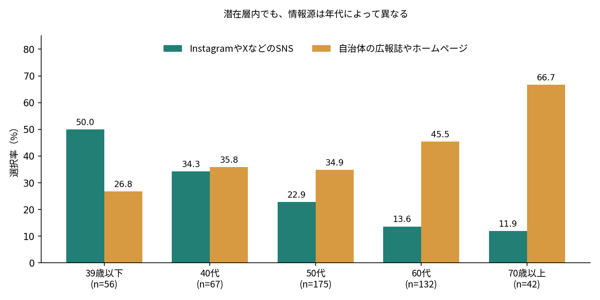

# 潜在層はどのような人たちか：元データによる探索的分析

2026年10月30日作成｜対象：2026年10月16日時点の元データ、有効回答674人。イベント企画だけに設問を絞った前回資料とは別の分析。今回も「内容によっては参加したい」を潜在層と定義する。

## 1．結論：年齢を完全に無視するのは適切ではない

潜在層は、日常の環境配慮行動をすでに行い、節約など生活上の利点を強く意識しながら、イベントへの参加を内容次第で検討する回答者である。「無関心な人」「まだ何もしていない人」とは言えない。一方、この定義はイベント参加意向の区分であり、環境関心そのものを測る尺度ではない。

年代別に潜在層となる割合に明確な差は検出されなかった（p=0.756、CramérのV=0.061）。しかし潜在層の中でも、SNS・自治体媒体の選択率や複数の実施行動には年代差がある。全体像は472人をまとめて説明し、情報源・年代差のある行動は年代別に補足するのが妥当。

「潜在層に多い」と「潜在層だけの特徴」は別である。交通・商品選びの難しさや特典への関心は潜在層で多いが、他層も選んでおり、潜在層固有の性質と断定しない。

## 2．対象と方法

| 区分 | 定義 | 人数 |
|---|---|---|
| 積極層 | ぜひ参加したい | 85 |
| 潜在層 | 内容によっては参加したい | 472 |
| 消極層 | あまり参加したいと思わない＋参加したくない | 117 |

元データは674行・19列。主にQ1〜Q3の属性、Q4の実施行動、Q5の難しい行動、Q6の意識と理由、Q7の置き配状況、Q8のキャンペーン認知・意向、Q9の情報源、Q10の参加意向・企画を用いた。個別自由記述と回答ID・時刻は成果物に掲載しない。回答IDは一意だが、同じ人による別ID回答がないことまでは確認できない。

クロス集計で人数・割合を比較し、χ²（カイ二乗）検定で回答の分布に関連があるかを調べた。期待される人数が小さい表は、固定周辺度数のモンテカルロ法（49,999回、乱数種固定）を使った。年齢・性別などを同時に考慮する補助分析として、ロジスティック回帰を用いた。

回答数が少ない10代5人・20代12人を単独で安定して比較するのは難しい。そのため主解析の年代は39歳以下、40代、50代、60代、70歳以上の5群。39歳以下は30代も含み、「若者」と同義ではない。元の8年代のままの検定も参考として行った。

## 3．潜在層の日常行動：多くの身近な行動は実践済み

| 行動 | 積極層% | 潜在層% | 消極層% |
|---|---|---|---|
| マイバッグ・マイボトルを利用する | 88.2 | 89.2 | 82.9 |
| ごみを分別する | 87.1 | 85.0 | 86.3 |
| 電気・照明をこまめに消す | 78.8 | 69.7 | 67.5 |
| 食べ残しを減らす | 75.3 | 64.4 | 67.5 |
| 物を長く使う・修理して使う | 72.9 | 64.4 | 60.7 |
| 不要になった物をリユース・リサイクルする | 63.5 | 61.4 | 58.1 |
| 冷暖房の使用を適切にする | 58.8 | 56.6 | 51.3 |
| 徒歩・自転車・公共交通機関を利用する | 61.2 | 48.5 | 44.4 |
| 食品を必要な分だけ購入する | 51.8 | 45.3 | 40.2 |
| 環境に配慮した商品を選ぶ | 48.2 | 24.4 | 17.9 |

潜在層ではマイバッグ・マイボトル421人（89.2%）、分別401人（85.0%）などは高い。一方、環境に配慮した商品選びは115人（24.4%）で、積極層48.2%との差が大きい。この項目の3層全体の分布差はBH補正後も検出された（q=0.0000268、V=0.197）。この検定だけで「潜在対積極」の個別比較まで有意と判定したものではない。

10種類の実施行動の平均選択数は、積極層6.86、潜在層6.09、消極層5.77。「その他」は数に含めていない。行動数は種類の幅を表す便宜的指標で、頻度やCO₂削減量、行動の質を測る点数ではない。

## 4．動機：潜在層では経済的理由が中心

| Q6の主な回答 | 積極層% | 潜在層% | 消極層% |
|---|---|---|---|
| 意識している（光熱費の削減など経済的理由のため） | 51.8 | 71.0 | 68.4 |
| 意識している（地球環境を守るため） | 42.4 | 21.0 | 15.4 |
| 意識していない（面倒・つい忘れてしまうため） | 4.7 | 4.9 | 9.4 |

潜在層では335人（71.0%）が「光熱費削減など経済的理由」、99人（21.0%）が「地球環境を守るため」を選んだ。両者を合わせると434人（91.9%）が意識している側の回答。Q6は一番近い理由を一つ選ぶ設問なので、経済的理由を選んだ人が環境にも関心を持つ可能性は否定できない。

Q6全体の3層差はq=0.00392、V=0.157。積極層と比べると経済的理由の割合が高いが、消極層68.4%とも近い。「節約訴求は潜在層だけに効く」という結論ではない。施策として環境面と生活上の利点を併せて伝える仮説が考えられるが、その効果は未検証。

## 5．困難：交通と商品選びが上位。ただし潜在層固有とは言えない

| 難しい・続けにくい行動 | 潜在層人数 | 潜在層% |
|---|---|---|
| 徒歩・自転車・公共交通機関を利用する | 223 | 47.2 |
| 環境に配慮した商品を選ぶ | 189 | 40.0 |
| 食品を必要な分だけ購入する | 125 | 26.5 |
| 不要になった物をリユース・リサイクルする | 89 | 18.9 |
| 冷暖房の使用を適切にする | 83 | 17.6 |

交通手段223人（47.2%）、商品選び189人（40.0%）、必要な分だけの食品購入125人（26.5%）が上位。Q5の各項目は、3層比較でも潜在層内の年代比較でも、BH補正後5%で差を検出しなかった。したがって共通課題を探るための全体集計として使えるが、差がないと証明されたわけではない。

同じ人のQ4とQ5を組み合わせると、交通手段は「実施を選んでおらず、困難を選んだ」が179人（37.9%）。商品選びでは166人（35.2%）。一方、すでに実施していても困難を感じる人は交通44人、商品選び23人いる。「難しい＝やっていない」とは限らない。詳しい4区分の人数はExcelに収録した。

Q5で分かるのは難しい行動の種類であり、費用・立地・時間・手間・知識不足などの原因は直接分からない。Q6にある理由も節電等への意識の理由であり、そのまま交通や買い物の原因として読み替えない。次の調査では、交通・商品選びごとに難しさの理由を尋ねると施策に結び付きやすい。

## 6．置き配・施策への関心：実行済みだけでなく検討段階も多い

潜在層の置き配は、サービス利用中で宅配ボックスを今後検討したい145人（30.7%）、宅配ボックス利用経験あり120人（25.4%）、サービス未経験だが今後利用したい98人（20.8%）。異なる導入段階が混在している。Q7全体の3層差はq=0.0000268、V=0.174。

Q8では「知っていたが未利用・今後利用したい」232人（49.2%）、「知らなかったが今後情報を確認して利用したい」213人（45.1%）。合計445人（94.3%）に今後の利用意向がある。実際の利用済みは22人（4.7%）。ただし意向が実行に移るとは限らず、類似の意向は他層にも多い。Q8全体の3層差はq=0.000392、V=0.167。

この集計は利用・認知・意向を混ぜた選択肢の分布である。住宅形態や設置可否は測っていないため、宅配ボックスの未利用を意欲不足と解釈しない。

## 7．年代差：潜在層の割合と、潜在層内部の特徴を区別する

| 年代群 | 全体n | 潜在層n | 潜在層の割合% |
|---|---|---|---|
| 39歳以下 | 76 | 56 | 73.7 |
| 40代 | 102 | 67 | 65.7 |
| 50代 | 251 | 175 | 69.7 |
| 60代 | 183 | 132 | 72.1 |
| 70歳以上 | 62 | 42 | 67.7 |

年代群×参加意向3層の検定はp=0.756、V=0.061。5%でも1%でも「独立」を棄却しない。観測された関連は小さいが、同じ割合であるとの証明でも、すべての回答で年代を無視してよいとの結論でもない。

| 項目 | 39歳以下% | 70歳以上% | 未補正p | 補正q | V |
|---|---|---|---|---|---|
| InstagramやXなどのSNS | 50.0 | 11.9 | 3.21e-07 | 1.48e-05 | 0.275 |
| 自治体の広報誌やホームページ | 26.8 | 66.7 | 0.000381 | 0.0035 | 0.209 |
| 環境に配慮した商品を選ぶ | 10.7 | 47.6 | 8.98e-05 | 0.00207 | 0.224 |
| 徒歩・自転車・公共交通機関を利用する | 42.9 | 59.5 | 0.446 | 0.629 | 0.089 |

表は5年代すべてを使う検定の結果と、説明用の両端2群の割合を併記したもの。2群だけの検定結果ではない。SNSは50.0%→11.9%、自治体媒体は26.8%→66.7%、商品選びは10.7%→47.6%で、年代別の補足が必要。交通の難しさは全体でまとめて把握できる候補だが、等しさを証明したわけではない。

潜在層内46検定のBH補正後、5%で10項目、1%で8項目に差を検出。実施行動5項目、情報源2項目、企画2項目、Q6全体が5%で該当する。一方、Q5全項目、Q7全体、Q8全体では検出しなかった。年代差の有無は設問ごとに扱い、全設問を一括して「年齢は無関係」と判断しない。

元の8年代のままでも、SNS・自治体媒体と5つの実施行動、特典の年代差は補正後5%で残った。一方、Q6と「自分の行動が環境にどうつながるか分かる」の差は5%を超えた。後者は年代のまとめ方に敏感な探索的結果として扱う。感度分析をしても10〜20代の回答不足そのものは解決しない。

## 8．ロジスティック回帰：年齢などをそろえても見える関連はあるか

ロジスティック回帰は、ここでは「潜在層か、比較相手の層か」と複数の特徴の関連を同時に調べる方法。同じ年代・性別・行動数・困難数などを仮定した比較に近づけるが、未測定の事情までは調整できない。職業はこのモデルでは調整していない。

主モデルは潜在層対それ以外、補助モデルは潜在層対積極層、潜在層対消極層。年齢5群、性別、実施行動数、困難な行動数、経済的理由の選択を説明変数とした。性別の「その他」「回答しない」20人は回帰のみ除外し、主モデル654人（潜在層463人）、対積極546人、対消極571人。各変数が潜在層になる原因だと示す分析ではない。

| 説明変数（潜在対積極） | 調整オッズ比 | 95%信頼区間 | 補正q |
|---|---|---|---|
| 男性対女性 | 0.41 | 0.23〜0.72 | 0.0138 |
| 実施行動数_1項目増 | 0.85 | 0.76〜0.94 | 0.0138 |
| 経済的理由対その他理由 | 2.40 | 1.46〜3.95 | 0.013 |

積極層との比較では、経済的理由の選択は潜在層側のオッズが2.40倍（95%CI 1.46〜3.95、q=0.0130）。他の理由を選んだ人との比較であり、環境理由だけとの比較ではない。実施行動数が1つ多いほど潜在層側のオッズは0.85倍（95%CI 0.76〜0.94、q=0.0138）。男性対女性は0.41倍（q=0.0138）だが、性別により施策を限定すべきという意味ではない。

これらは補正後5%では検出されたが、1%では検出されていない。潜在層対それ以外、潜在層対消極層では補正後5%で有意な係数はなかった。潜在層全体を一つの属性で強く識別できたとは言えず、積極層と消極層をまとめると異なる特徴が見えにくくなる。

「オッズ」は確率÷（1−確率）。オッズ比2.4は「潜在層になる確率が2.4倍」ではない。95%信頼区間は推定の幅で、ここでは多重比較に同時対応した区間ではない。24係数をまとめたBH補正q値も併記して探索的に評価する。

3モデルとも収束し、説明変数間の重なりを測るVIFの最大は2.67〜2.75。年代4係数をまとめた検定もp=0.806／0.344／0.719で、明確な関連は検出していない。ただし行動数の直線的な関係などのモデル仮定、自己申告、未調整の職業・生活環境の影響が残る。予測精度や因果効果を検証したモデルではない。

## 9．p値・5%・1%をどう読むか

検定で最初に置く帰無仮説は「年代と回答は独立＝年代による回答分布の違いはない」。p<0.05なら5%でこの仮説を棄却し、差がある証拠とする。p<0.01なら1%でも棄却する。「年齢で変わるという命題を棄却したから年齢を無視する」という読み方は、通常の独立性検定とは逆になる。

pが大きい場合は「差を検出できなかった」。人数不足や推定の粗さでも大きくなるため、「差がない」と証明するものではない。本当に無視できる小ささを示したい場合は、例えば許容する差を事前に決める同等性検定や信頼区間による評価が必要。今回は許容差の事前合意がなく、同等性の証明はしていない。

多数の項目を検定すると偶然の有意差が増える。層比較49件、潜在層内年代比較46件、全回答者の年代比較46件、8年代の参考分析46件を、それぞれ一つのまとまりとしてBH法で補正。回帰24係数も一括補正した。q<0.05／0.01を主要な判定とし、未補正pだけで項目を選ばない。BH法は「発見した差の中の誤発見率」を扱い、どの結果も必ず正しいと保証するものではない。

CramérのVは0に近いほど関連が小さい効果量。今回の潜在層内SNSは0.275、商品選び0.224。分類表の大きさ等で解釈が変わるため、固定の目安だけで大・小を決めず、実際の選択率と人数も見る。有意差があっても施策上重要とは限らない。

## 10．データ品質と限界

元Q9は「一番よく参考にする情報源」を問うが、252人が複数媒体を回答している。最多の媒体を一つ答えたランキングではなく、「その媒体を選んだ人の割合」として扱った。広告の効果、閲覧頻度、媒体の排他的な好みは測っていない。

元Q10-2は「3項目選んでください」であり、前回の加工CSV見出し「最大3つ」とは異なる。674人中、3つ未満258人、ちょうど3つ262人、3つ超過154人。潜在層内では超過112人。主集計では削除せず、ちょうど3つの潜在層194人に限った企画の参考集計もExcelに収録した。制限の実装・転記仕様を確認する必要があり、どちらの集計も自動的に正解とはみなさない。

全回答者で50〜60代が64.4%、女性が78.2%。潜在層でも50〜60代が65.0%、女性81.6%、学生4人。アプリ登録者等による回答のため、県民全体・若者全体を代表しない。p値や95%信頼区間はこの偏りを解消しない。選択なしを「頻度ゼロ」、意向を「実際の行動」と読み替えない。

自由記述を今回の統計モデルには含めていないため、心理的な理由の掘り下げには限界がある。特に費用・時間・住環境などの条件は追加質問や聞き取りが必要。今回の結果は探索的で、事前登録された仮説の確認や無作為化された施策実験ではない。

## 11．今回の分析から使える説明と、次の一手

説明例：「イベント参加を内容次第で検討する人は、環境配慮行動をしていない人ではなく、日常の行動を実践しながら、経済的な利点を意識する人が多かった。交通や商品選びに難しさを感じる人も多く、実践しやすい方法を伝える余地がある。ただし、情報源や一部の行動には年代差があり、年齢を一律に無視することはできない。」

分析の使い分け：全472人で共通の実践行動と困難の上位を把握する。広報は年代別の情報源を参照する。行動支援は交通・買い物の障壁の原因を追加調査する。イベント企画は前回の人気順も使いつつ、特典などに年代差があることを補足する。

追加質問の例：商品選びなら「価格・見分け方・購入場所・品質への不安・その他」、交通なら「距離・所要時間・本数・荷物や送迎・身体条件・その他」。実践しているかと難しさを別々に聞き、複数理由を回答できるようにする。回答項目は事前に整理し、個別事情を断定しない。

## 12．ファイルの見方と再実行

Excel「潜在層の特徴_統計分析.xlsx」は、説明と注意点→層構成→Q4／Q5／Q6等の順に読む。検定の詳細は「層比較_検定」「年代差_潜在層検定」、調整後の関連は「回帰_調整済み」。積極・潜在・消極の3群検定は、どこかの分布が異なるかの検定であり、各ペアの差の有意性をそのまま意味しない。

再現手順：Pythonでpandas・numpy・scipy・statsmodels・patsy・openpyxl・python-docx・reportlab・matplotlibを用意し、python analyze_profile.py "元CSVのパス"、続いてpython create_report.pyを実行する。元CSVはリポジトリに追加していないため、再実行する人は元データを安全な場所に用意する。解析メタデータにはファイル名・SHA-256・乱数条件を記録。

